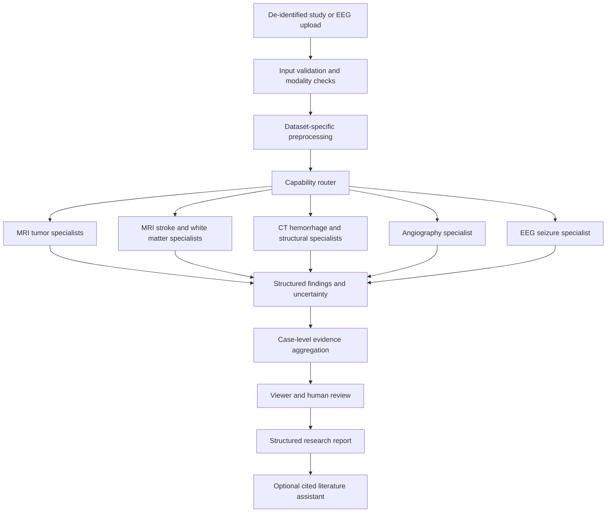

# NeuroFusion Project Manual

Version 2.0 | 5 October 2026

Status: proposed research architecture and implementation guide. No NeuroFusion models, application, or clinical capability have been implemented or validated by creating this manual.

## 1. Purpose and intended outcome

NeuroFusion is a proposed research platform for analyzing selected neurological abnormalities using specialist models for MRI, CT, angiographic imaging, and EEG. It combines compatible information from the same examination, displays model findings with uncertainty, and supports human review.

The objective is broad, measurable coverage of supported findings, rather than a universal detector of every brain disease. A growing collection of models cannot establish comprehensive coverage: each finding requires appropriate inputs, reliable labels, independent evaluation, and a defined population.

The primary users of the research prototype are its developers, imaging researchers, and qualified clinical collaborators. Outputs are research findings, not independent diagnoses, treatment recommendations, clearance that a brain is healthy, or predictions of imminent harm.

The first complete release should analyze one volumetric MRI task, compare fusion methods, display editable lesion masks, calculate validated measurements, and export reproducible results. Subsequent releases add independently evaluated specialist modules.

Delivery format: a browser-based application, developed locally and later deployable to a server. Windows executable packaging is outside the agreed scope. GitHub hosts source and documentation; the full online application requires backend hosting for inference.

The approved expansion adds six high-priority features and one advanced feature to the required roadmap: active learning, finding-to-evidence links, collaborative review, dataset leakage detection, a fusion experiment lab, robustness testing, and federated-learning experiments. Their specifications and acceptance gates are in Section 26. These are planned requirements, not implemented capabilities.

## 2. How to use this manual

1. Read the coverage matrix and select the first clinical research task.
2. Confirm computing resources and dataset access before choosing model sizes.
3. Complete the dataset audit and freeze patient-level partitions.
4. Build a baseline and evaluation pipeline before advanced fusion.
5. Follow the release gates; do not activate a module merely because training finishes.
6. Keep a capability registry so the interface exposes only validated input-task combinations.

All architecture and model choices below are proposals. Dataset facts are linked to primary sources in Section 25. Access conditions, available labels, and releases must be checked again when downloading.

## 3. Capability status definitions

| Status | Meaning |
|---|---|
| Planned core | A task with an identified dataset and a reasonably defined experiment; not yet implemented |
| Planned extension | A candidate task requiring additional engineering, access checks, or label audits |
| Data-dependent | A desired feature without a verified, sufficient training and evaluation cohort |
| Not supported | A finding or use outside the activated model's validated scope |
| Research validated | Passed the project's documented research acceptance criteria; this does not mean clinically approved |

Every module must declare its population, modality, sequence requirements, target labels, output level, evaluation results, and failure conditions.

## 4. Expanded abnormality and data coverage matrix

The following entries are overlapping clinical or imaging categories, not an exhaustive list of brain diseases. They must not be counted as independent diseases to inflate coverage.

| Target | Required input | Proposed dataset | Proposed output | Scope |
|---|---|---|---|---|
| Glioma-related tumor regions | T1, contrast-enhanced T1, T2, FLAIR MRI according to the selected release | BraTS [1] | Region masks, lesion extent and volume | Planned core |
| Selected tumor image categories | Supported 2D contrast-enhanced T1 images | BRISC [2] | Glioma, meningioma, pituitary tumor, non-tumorous class scores | Planned extension; separate 2D experiment |
| Brain metastases | Matched MRI sequences defined by the release | BraTS-METS [3] | Candidate metastatic-lesion masks and counts | Planned extension |
| Pediatric tumor regions | Supported pediatric MRI | BraTS-PEDs [4] | Tumor segmentation within the dataset's population | Planned extension; separate pediatric evaluation |
| Acute/subacute ischemic stroke lesions | DWI, ADC, FLAIR MRI | ISLES 2022 [5] | Lesion masks, counts and volume | Planned core; recommended first fusion task |
| Established stroke lesions | Supported T1 MRI | ATLAS [6] | Stroke-lesion segmentation | Planned extension; use chronicity metadata |
| Intracranial hemorrhage | Supported non-contrast head CT | RSNA ICH [7] | Presence and hemorrhage subtype scores | Planned core after first MRI release |
| Aneurysm candidates | Compatible CTA, MRA, or MRI protocol | RSNA aneurysm dataset [8] | Candidate presence and location | Planned extension |
| White matter hyperintensities | T1 and FLAIR MRI | WMH challenge [9] | WMH segmentation and burden | Planned extension; not an etiologic diagnosis |
| Cerebral microbleeds | Susceptibility-sensitive MRI according to the release | VALDO task 2 [10] | Candidate microbleed locations and masks | Planned extension |
| Lacunes of presumed vascular origin | Required VALDO task sequences | VALDO task 3 [10] | Candidate lesion locations and segmentation | Planned extension |
| Enlarged perivascular spaces | Required VALDO task sequences | VALDO task 1 [10] | Quantitative imaging-marker segmentation | Optional extension; not inherently a dangerous finding |
| New lesions in multiple sclerosis follow-up | Matched longitudinal MRI, particularly supported FLAIR acquisitions | MSSEG-2 candidate [11] | Candidate new-lesion masks | Planned extension after data access and protocol audit |
| Atrophy patterns and Alzheimer-related research endpoints | Structural MRI, optionally matched PET, cognitive and clinical records | ADNI [12] | Regional measurements and explicitly defined research predictions | Planned extension; not diagnosis from MRI alone |
| Seizure events during recordings | Multichannel scalp EEG | TUH Seizure Corpus and CHB-MIT [13,14] | Event intervals and probabilities | Planned extension; electrical-signal branch |
| CT mass effect, midline shift and skull fracture | Supported head CT | CQ500 [15] | Study-level finding flags where labels exist | Planned extension; small benchmark, additional development data needed |

The hemorrhage branch covers the RSNA labels: intraparenchymal, intraventricular, subarachnoid, subdural, and epidural hemorrhage. A model predicting these labels is not automatically a bleeding segmentation model.

BraTS tumor-related edema/invaded-tissue masks are not labels for all causes of brain swelling. An aneurysm location label does not establish rupture risk. Stroke-lesion segmentation does not independently determine stroke timing, cause, or treatment eligibility. Seizure-event detection does not establish that a person has epilepsy or predict future seizures.

## 5. Additional desired coverage requiring new evidence

Keep the following on a data-dependent backlog, rather than advertising them as detected conditions:

- Hydrocephalus and ventricular enlargement: require suitable positive/negative cohorts and clinical definitions. Ventricular size alone cannot establish the diagnosis.
- Diffuse edema, herniation, and quantitative midline-shift measurement: require appropriate annotations and geometry. Existing image-level flags do not supply measurement supervision.
- Traumatic contusions and diffuse axonal injury: need task-specific CT/MRI cohorts. Hemorrhage or fracture detection does not cover all traumatic brain injury.
- Abscesses, encephalitis, meningitis, and other infections: need appropriate imaging and clinical or laboratory reference standards.
- Arteriovenous malformations, arterial stenosis/occlusion, and cerebral venous thrombosis: need dedicated vascular datasets and acquisition protocols.
- Hypoxic-ischemic injury and toxic/metabolic injury: need carefully defined populations, imaging time points, and reference labels.
- Congenital malformations and cortical dysplasia: need specialist annotations, population controls, and separate evaluation.
- Parkinsonian and other neurodegenerative syndromes: need disease-specific clinical cohorts; do not extrapolate ADNI results.

Migraine, psychiatric conditions, raised intracranial pressure, and many neurological disorders cannot be treated as generic labels recoverable from an arbitrary brain image. A model must have a defensible input-to-target relationship before it enters development.

## 6. Dataset acquisition and governance

For each candidate dataset, complete a record containing:

- Name, exact release, original URL, download date, checksums and citation.
- Access requirements, applicable terms, permitted uses and redistribution limits.
- Modality, sequences, file formats, scanner/site information and population.
- Patient, examination, series, slice and time-point identifiers where available.
- Label type: study, slice, point, bounding box, segmentation, event, or clinical endpoint.
- Class balance, negative cases, ambiguous labels, excluded cases and known limitations.
- Official splits and whether test labels are available.
- Relationships to other datasets that may reuse the same patients or images.

Do not assume a publicly described dataset is an unrestricted download. Some require registration, access approval, or acceptance of research-use terms. Public challenge test labels may remain hidden.

Important initial audits:

1. BRISC is a 2D image dataset with incomplete patient identification. Its paper reports that complete subject independence cannot be guaranteed. Its non-tumorous class is not equivalent to healthy [2].
2. BraTS releases and source collections may overlap. Deduplicate at patient level where mappings exist [1].
3. ISLES 2022 publishes 250 training cases; its 150 test cases are reserved for challenge evaluation. Create internal validation splits from training data without calling them the official test set [5].
4. ATLAS releases overlap. Preserve historical membership when constructing development and external evaluation partitions [6].
5. CHB-MIT is a pediatric, selected epilepsy cohort; performance is not evidence of adult population screening [14].
6. CQ500 is best treated as a held-out benchmark when possible. If used for training, it cannot simultaneously remain an independent test set [15].

Never label an unannotated condition as absent. A tumor dataset generally does not establish reliable negative labels for every other neurological disease.

## 7. Data organization and partitions

Use separate dataset adapters with a common internal schema. Preserve original files and write transformations to derived directories.

Suggested manifest fields:

```text
dataset_id, dataset_version, subject_id, study_id, series_id,
visit_id, modality, sequence, image_path, annotation_path,
annotation_type, target, site_id, age_group, split,
spacing, orientation, checksum, provenance, license_reference
```

Split by patient before slice extraction or augmentation. Keep all visits from one patient in the same partition unless the experiment explicitly uses a different leakage-controlled design. Freeze a test partition before tuning. Prefer institution-held-out evaluation when feasible.

For datasets without trustworthy patient identifiers, document the limitation and perform duplicate and near-duplicate checks; these checks cannot prove patient independence. Maintain an independent external evaluation cohort for strong generalization claims.

## 8. System architecture



The router selects models using verified modality/sequence metadata and input checks. It does not send every scan to every model. Where multiple compatible targets are assessed, outputs are multi-label; abnormalities can coexist.

Use an API service for requests and a separate worker for inference. Begin with a simple job queue, one GPU worker and local artifact storage. Add distributed services only when load or isolation requirements justify them.

## 9. Input and preprocessing contracts

### MRI

- Read volumes with physical spacing and orientation preserved.
- Verify expected sequences rather than trusting filenames alone.
- Register same-examination sequences when necessary and inspect alignment.
- Apply training-consistent normalization and resampling.
- Preserve transformations so predictions can be mapped back to source space.
- Track skull stripping and other prerequisites used by the training dataset.
- Detect missing, corrupt, or unsupported inputs and abstain when requirements are unmet.

### CT and angiography

- Assemble series using reliable spatial metadata.
- Preserve and validate intensity rescaling and physical geometry.
- Apply task-specific windows and preprocessing.
- Distinguish non-contrast CT from CTA and other unsupported acquisitions.
- Do not apply MRI preprocessing to CT.

### EEG

- Validate channel names, montage, sample rate and recording duration.
- Apply documented filtering/resampling and artifact handling.
- Keep patient partitions fixed before creating overlapping windows.
- Retain timing so event predictions map to the original recording.

### 2D images

Provide an isolated BRISC research path. A JPEG without trustworthy physical geometry cannot support milliliter volume measurements, and unrelated slices must not be assembled into a fictional 3D scan.

## 10. Model portfolio

| Role | Baseline proposal | Advanced experiment | Activation condition |
|---|---|---|---|
| 3D lesion segmentation | 3D U-Net or nnU-Net-style baseline | Separate MRI encoders with feature fusion; compare a transformer-based model | Verified masks, geometry and patient-level evaluation |
| 2D tumor classification | Transfer-learned CNN | CNN/transformer ensemble | Reliable image labels and disclosed split limitations |
| CT hemorrhage | Slice encoder with study-level aggregation | 3D or attention-based aggregation | Correct mapping between slice and study targets |
| Aneurysm localization | Candidate detector with false-positive reduction | Joint vessel/context features where data supports them | Appropriate point/region supervision and location evaluation |
| White matter and small lesions | Task-specific 3D segmentation | Multiscale lesion refinement | Lesion-level sensitivity and false-positive evaluation |
| Longitudinal MS lesions | Aligned paired-scan baseline | Siamese temporal model | Same-patient paired scans and new-lesion labels |
| EEG seizures | 1D CNN or temporal convolutional network | Temporal attention/transformer | Event annotations, patient-independent testing |
| Atrophy measurements | Validated anatomical segmentation baseline | Longitudinal measurement model | Appropriate reference annotations and normative context |
| Research endpoint fusion | Simple tabular baseline | Matched MRI/PET/clinical feature fusion | Same-patient endpoints, aligned visits, no label leakage |

These are candidate architectures, not promised winners. Build and measure one baseline per task before adding complexity. A model registry can contain many specialists without loading them all into GPU memory at once.

## 11. Fusion design

### A. Early fusion

Stack aligned sequences from the same examination as channels. This is the first multimodal baseline, because it is comparatively simple and exposes whether multiple sequences add value.

### B. Feature fusion

Use sequence-specific encoders and combine learned features with concatenation, gating, or cross-attention. Candidate examples:

- DWI + ADC + FLAIR for ISLES lesion segmentation.
- T1 + contrast-enhanced T1 + T2 + FLAIR for a compatible BraTS task.

All inputs must correspond to the same patient and relevant examination, with spatial alignment verified. Compare against early fusion using the same partitions and training budget.

### C. Model ensembles

Combine predictions from models trained for the same target on compatible inputs. Calibrate and select combination weights on validation data. Quantify whether improvement justifies extra inference cost. Model disagreement is a useful signal, not a guarantee that errors are detected.

### D. Longitudinal fusion

Compare matched visits after registration. Display dates, acquisition changes, mask uncertainty and measurement variability. An apparent volume difference is not automatically biological progression.

### E. Cross-specialist evidence aggregation

Combine structured findings into a report without averaging unrelated disease probabilities. Do not normalize tumor, stroke and seizure scores into a single probability distribution or universal danger score.

Learned case-level fusion is a later experiment requiring a suitably labeled multimodal cohort. Do not create artificial pairs from unrelated MRI, CT, PET, or EEG subjects.

### F. Missing inputs

The default is to mark unsupported tasks as not assessed. Train missing-sequence variants only when their performance is separately evaluated. Do not silently synthesize a missing sequence and present it as acquired evidence.

## 12. Findings and uncertainty contract

Each result should carry:

```json
{
  "study_id": "research-study-001",
  "module_id": "stroke_mri",
  "model_version": "candidate-001",
  "assessment_status": "completed",
  "target": "ischemic_lesion",
  "finding_status": "candidate_present",
  "score": null,
  "calibration_version": null,
  "mask_artifact": "artifact-reference",
  "measurements": [],
  "input_series": ["dwi-series", "adc-series", "flair-series"],
  "limitations": [],
  "review_status": "unreviewed"
}
```

Allowed assessment statuses include completed, not_assessed, failed and abstained. Finding status applies only to completed tasks and must be interpreted within their scope.

Do not show an uncalibrated neural-network score as a patient's probability of disease. Choose thresholds on validation data, freeze them, and report sensitivity/false-positive trade-offs. Display unreliable or unfamiliar inputs for review; out-of-distribution detection cannot guarantee recognition of every unseen abnormality.

## 13. Viewer and human review workflow

The interface should provide:

1. Study import with de-identification checks and an input summary.
2. A list of compatible, unavailable and unsupported analyses.
3. Job progress and readable failure messages.
4. Axial, sagittal and coronal views for valid volumes.
5. Adjustable mask overlays and optional 3D lesion rendering.
6. Predicted lesion measurements with units and geometry provenance.
7. Confidence/disagreement layers with explanations of their limitations.
8. Manual mask editing and reviewer comments.
9. Side-by-side matched examinations when available.
10. Structured report preview and export.

Preserve the original model output when a reviewer edits a mask. Store the revision, reviewer, timestamp and model version. Corrections enter a reviewed annotation queue; they do not automatically become training truth or update deployed models.

The interface must not display an overall green 'brain healthy' badge. Show condition-specific results and explicit coverage gaps.

## 14. Reporting and RAG integration

Start with deterministic report templates populated from validated structured outputs. Include:

- Input examination and supported sequences.
- Model versions and processing status.
- Candidate findings, masks and measurements.
- Not-assessed tasks, quality problems and uncertainty.
- Reviewer edits and review status.
- Research-use statement and traceable artifact references.

Later, adapt TechRAG Architect's retrieval, reranking and citation-validation components for a curated neurological literature library. The RAG assistant may explain terms, locate methodology papers, and summarize documented limitations.

It must not invent imaging findings, convert missing evidence into negative results, give treatment instructions, or describe a source citation as validation of an individual prediction. A citation-format check is not a clinical factuality check. Evaluate report faithfulness against structured outputs and expert-reviewed references.

Keep literature indexing separate from patient information. Do not send identifiable data to external model providers by default.

## 15. Backend, storage and interfaces

Suggested components:

- Python and PyTorch/MONAI for imaging pipelines [16].
- A separate EEG processing adapter and temporal model pipeline.
- FastAPI for study registration, inference jobs, findings and review actions.
- A task queue and worker processes for long-running processing.
- PostgreSQL for metadata, job states, model records and review history.
- Filesystem or object storage for original scans, derived images, masks and reports.
- A web interface with a medical-image viewer selected after a DICOM/NIfTI compatibility prototype.
- TensorBoard or an experiment tracker for training and evaluation.

Proposed API surface, not implemented endpoints:

```text
POST /studies                 Register an uploaded research study
GET  /studies/{id}            Read metadata and available series
GET  /studies/{id}/capabilities
POST /jobs                   Request compatible analyses
GET  /jobs/{id}               Read processing state
GET  /studies/{id}/findings    Read structured findings
POST /findings/{id}/reviews   Save review and annotation revisions
POST /studies/{id}/reports    Generate a research report
GET  /models                 Read model capability cards
GET  /evaluations             Inspect recorded benchmark results
```

Support cancellation, explicit failures, resource limits, and idempotent job submission. The health endpoint should distinguish API availability from model and worker readiness.

## 16. Repository structure

```text
neurofusion/
  backend/
  frontend/
  pipelines/
    preprocessing/
    registration/
    mri/
    ct/
    angiography/
    eeg/
  models/
    tumor/
    stroke/
    hemorrhage/
    vascular/
    white_matter/
    neurodegeneration/
    seizures/
    fusion/
  datasets/
    adapters/
    manifests/
    splits/
  evaluation/
    metrics/
    benchmarks/
    calibration/
    external_validation/
  reporting/
    templates/
    rag/
  configs/
  scripts/
  tests/
  docs/
  artifacts/                 Ignored or stored outside Git
  README.md
```

Large scans, protected data and model artifacts should not be committed to the source repository. Track reproducible manifests, configuration and permitted references instead.

## 17. Training workflow

1. Audit one dataset and visually inspect representative labels.
2. Freeze patient-level development, validation and test partitions.
3. Implement a deterministic adapter and geometry checks.
4. Run a tiny-sample overfit experiment to debug the training pipeline.
5. Train a simple baseline with recorded seeds and configuration.
6. Evaluate errors by lesion size, site, sequence and population where metadata supports it.
7. Introduce fusion or another architecture as a controlled experiment.
8. Calibrate outputs and select operating thresholds using validation data only.
9. Freeze the candidate and evaluate on the untouched test partition.
10. Evaluate on an external compatible cohort before broader claims.

Record preprocessing version, dataset checksums, split manifest, seed, model settings, training budget, checkpoint selection rule and environment dependencies. Save failed experiments as well as successful ones.

For multi-task training with incomplete labels, use explicit label masks so an unknown label contributes no false negative supervision. Monitor each task separately for negative transfer.

## 18. Evaluation plan

| Task | Required measurements |
|---|---|
| Study/image classification | Sensitivity, specificity, precision, AUROC/AUPRC where appropriate, confusion matrix, calibration |
| Segmentation | Dice, boundary distance such as HD95, volume error, lesion-level sensitivity and false positives |
| Small-lesion localization | Lesion sensitivity at stated false-positive rates, stratified by lesion size |
| EEG events | Event sensitivity, false alarms per hour, detection latency with a documented event-matching rule |
| Longitudinal measurement | Agreement with reference changes, registration failures and measurement repeatability |
| Reports | Correctness of measurements, unsupported claims, omitted limitations and citation relevance |
| System | Runtime, peak memory, job failures, missing-input handling and reproducibility |

Calculate confidence intervals at the patient level where appropriate; slices from one patient are correlated. Define empty-mask handling and do not silently omit normal or failed cases.

The core fusion study should compare a single sequence, channel stacking, and separate-encoder fusion using identical partitions. Repeat runs when feasible and report both performance and computational cost. A modest result with honest external testing is stronger than an inflated slice-level accuracy.

Do not choose a generic 95% accuracy target. Set research acceptance thresholds with a clinical collaborator for the specific task and intended use, including acceptable false positives and subgroup failures. Public benchmark success is not clinical deployment approval.

## 19. Testing and reliability

Meaningful automated checks should cover:

- Volume orientation, spacing, and mask alignment round trips.
- Correct patient split membership and duplicate detection.
- Sequence availability and routing to compatible models.
- Preservation of unknown labels during training.
- Measurement units and transformation back to source space.
- Job cancellation, failure handling and artifact persistence.
- Review history and preservation of original model outputs.
- Report values matching structured findings.
- Refusal to infer unsupported capabilities or fabricate missing data.

Use de-identified fixtures. Include a small end-to-end research case for each activated module, plus corrupt and incomplete inputs. Test resource failures without damaging stored studies.

## 20. Hardware and resource planning

Do not buy hardware before benchmarking the first pipeline. Memory demand depends on patch size, sequence count, network width, batch size and precision.

As an initial planning assumption, a single modern GPU can support small 2D and patch-based 3D experiments; full-volume transformers and multiple simultaneous models may require substantially more memory. Use smaller patches, mixed precision where numerically appropriate, gradient accumulation, and sliding-window inference when necessary.

Collect these measurements before estimating project cost:

- Downloaded and expanded dataset sizes.
- Preprocessing disk footprint and duration.
- GPU memory for one forward/backward pass.
- Steps per second and validation duration.
- Inference latency for a complete study.
- Storage for checkpoints, derived volumes and reports.

Run one specialist at a time initially. Schedule experiments rather than leaving every model resident in memory. Cloud use requires a cost estimate and confirmation that data terms and privacy arrangements permit it.

## 21. Development releases and gates

| Release | Deliverables | Exit gate |
|---|---|---|
| 0: Feasibility | Dataset register, resource benchmark, selected first task, frozen splits | Access, labels and compute are adequate |
| 1: MRI baseline | ISLES or BraTS baseline, geometry pipeline, evaluation | Reproducible results and inspected failure cases |
| 2: Fusion research | Early versus feature fusion, missing-input behavior | Controlled comparison with documented outcome |
| 3: Usable research app | Import, viewer, measurements, jobs, reports | End-to-end held-out case and failure-path checks |
| 4: Second specialist | Tumor or stroke branch not selected first, then CT hemorrhage | Independent task evaluation and routing tests |
| 5: Broader imaging | Aneurysms, WMH, microbleeds/lacunes, selected tumor extensions | Per-module data and validation gates |
| 6: Temporal and EEG | Longitudinal analysis, MS lesions, EEG events | Suitable paired/event data and separate evaluation |
| 7: Multimodal research | ADNI-based endpoints, matched-data fusion | Endpoint definition and leakage-controlled cohort |
| 8: Review and knowledge | Reviewer workflows and cited literature assistant | Faithful reports and traceable human changes |

Viewer, reporting and review work may progress alongside model work. Advanced modules remain disabled until their own gates pass. This broad scope is a multi-release research program, not a short assignment; timing should follow the feasibility benchmark and available team effort.

## 22. Progress dashboard

Maintain a project board with a row per module and these columns:

```text
Dataset access | Label audit | Split freeze | Baseline |
Fusion experiment | Internal evaluation | External evaluation |
Viewer integration | Documentation | Activation status
```

Show training/validation curves, task metrics, confidence intervals, throughput, GPU memory and representative failure cases. Keep performance grouped by dataset and target; do not publish one blended accuracy for the whole platform.

Every release should include before/after model comparisons on the same held-out cases. Record whether added complexity improved results. Retaining a simpler baseline is a valid outcome.

## 23. Privacy and clinical boundaries

Use research datasets and de-identified examples for development. Check both metadata and burned-in image identifiers before sharing. Limit access, preserve review/audit history and define retention/deletion procedures.

The prototype must not make treatment recommendations, declare all disease absent, generate an unsupported urgency score, or operate as autonomous emergency triage. Clinical deployment would require appropriately designed clinical validation and review of the applicable institutional and regulatory requirements with qualified professionals.

No model can establish full coverage of all brain harm from arbitrary inputs. The application must say which findings were assessed, which were not, and why.

## 24. First implementation checklist and deliverables

Immediate steps:

1. Confirm CPU, GPU/VRAM, RAM, available disk, operating system, team size and project deadline.
2. Choose ISLES fusion as the default first experiment, or explicitly choose BraTS.
3. Request/download the chosen training data through its official channel and record terms.
4. Inspect a small number of complete studies and masks in a viewer.
5. Build the manifest and patient-level partitions.
6. Implement one baseline with a tiny debugging run before full training.
7. Add evaluation, artifact provenance and a minimal viewer.
8. Compare fusion methods; then decide which specialist to add next.

Final research deliverables:

- Reproducible repository and setup documentation.
- Dataset provenance register and fixed partition manifests.
- Model cards and per-module capability registry.
- Baselines, fusion comparisons and saved model artifacts.
- Internal and external evaluation reports with limitations.
- Interactive scan/EEG review application.
- Structured report export and optional cited literature assistant.
- Recorded demonstration using de-identified held-out examples.
- Known-failures register and a prioritized extension roadmap.
- The six high-priority feature deliverables and the advanced federated-learning experiment specified in Section 26.

Completion of this manual is a planning deliverable only. Dataset downloads, trained weights, application code, and clinical validation are not included in this deliverable.

## 25. Primary sources and dataset starting points

Sources checked on 5 October 2026. A linked dataset or challenge is a starting point, not confirmation that every file or annotation is currently downloadable without approval.

1. **BraTS 2021:** MRI sequences, labels, preprocessing, access and overlap with previous releases. https://www.med.upenn.edu/cbica/brats2021/
2. **BRISC paper and dataset:** 2D classification/segmentation, source overlap and patient-identity limitations. https://www.nature.com/articles/s41597-026-06753-y and https://www.kaggle.com/datasets/briscdataset/brisc2025/
3. **BraTS-METS research description:** brain metastasis segmentation. https://arxiv.org/abs/2306.00838
4. **BraTS-PEDs collection:** pediatric tumor imaging. https://www.cancerimagingarchive.net/collection/brats-peds/
5. **ISLES 2022:** DWI/ADC/FLAIR stroke-lesion dataset, public training and hidden testing. https://www.nature.com/articles/s41597-022-01875-5 and https://doi.org/10.5281/zenodo.7153326
6. **ATLAS:** current dataset description and release notes. https://fcon_1000.projects.nitrc.org/indi/retro/atlas.html and https://github.com/npnl/ATLAS
7. **RSNA intracranial hemorrhage:** task and dataset provenance. https://www.rsna.org/artificial-intelligence/ai-image-challenge/RSNA-Intracranial-Hemorrhage-Detection-Challenge-2019 and https://pubs.rsna.org/doi/10.1148/ryai.2020190211
8. **RSNA aneurysm challenge:** modality and localization scope. https://www.rsna.org/artificial-intelligence/ai-image-challenge/intracranial-aneurysm-detection-ai-challenge
9. **WMH challenge publication:** T1/FLAIR images and segmentation labels. https://pmc.ncbi.nlm.nih.gov/articles/PMC7590957/
10. **VALDO challenge and training data:** microbleeds, lacunes and enlarged perivascular spaces. https://valdo.grand-challenge.org/ and https://zenodo.org/records/4520773
11. **MSSEG-2:** listed by MICCAI as the multiple-sclerosis new-lesion segmentation challenge. Dataset contents/access require confirmation; the linked record could not be opened during preparation. https://www.miccai2021.org/en/MICCAI2021-CHALLENGES.html and https://doi.org/10.5281/zenodo.4575408
12. **ADNI:** MRI, PET and documentation of the longitudinal research cohort. https://adni.loni.usc.edu/data-samples/adni-data/neuroimaging/mri/ and https://adni.loni.usc.edu/data-samples/adni-data/neuroimaging/pet/ and https://adni.loni.usc.edu/help-faqs/adni-documentation/
13. **TUH EEG:** seizure corpus and access information. https://isip.piconepress.com/projects/tuh_eeg/ and https://isip.piconepress.com/projects/nedc/html/tuh_eeg/index.shtml
14. **CHB-MIT:** pediatric scalp EEG seizure recordings. https://physionet.org/content/chbmit/1.0.0/
15. **CQ500 source study:** CT hemorrhage, fracture, mass effect and midline shift labels. Verify present download access separately. https://arxiv.org/abs/1803.05854
16. **MONAI:** medical-imaging framework and examples. https://github.com/Project-MONAI/MONAI and https://github.com/Project-MONAI/tutorials
17. **MONAI Label:** annotation workflows and active-learning interfaces. https://docs.monai.io/projects/label/en/latest/index.html and https://github.com/Project-MONAI/MONAILabel/wiki/Active-Learning
18. **MONAI federated learning:** interfaces for federated model development. https://monai.readthedocs.io/en/latest/fl.html

## 26. Approved priority feature expansion

All seven features below belong to the planned project. High priority means they should be integrated into the core research workflow; advanced means the feature depends on mature baselines and requires a later experimental release. Adding these requirements does not imply that their implementation or validation has begun.

### 26.1 Active-learning queue  -  high priority

Purpose: prioritize useful unlabeled development cases for qualified annotation, using a combination of uncertainty and diversity instead of annotating only easy or repetitive cases.

Workflow:

1. Score eligible development cases using a versioned selection strategy.
2. Present ranked cases with selection reasons and task compatibility.
3. Assign annotation tasks to reviewers.
4. Route corrected labels through review and, where needed, adjudication.
5. Freeze an approved annotation version for a new training experiment.

Never sample from protected test cohorts for training. Do not automatically retrain or replace a running model after a correction. Candidate selection is annotation prioritization, not clinical urgency prioritization. MONAI Label is a candidate implementation foundation [17].

Acceptance: compare active selection against random selection under equal annotation budgets; report held-out performance, annotation effort and selection diversity. Verify test-set exclusion and trace each new training label to its approved revision.

### 26.2 Finding-to-evidence links  -  high priority

Purpose: let a reviewer trace every finding and measurement to its actual source evidence.

Each finding stores the study and series identifiers, physical-space coordinates, frame/slice or EEG interval, original and derived artifact versions, model version, preprocessing version, and mask revision. Volume measurements link to both the mask and spacing used in their calculation.

Clicking a report finding opens the corresponding viewer location and overlay. Preserve the coordinate transforms rather than relying on a slice index that may change after resampling. Exported reports retain stable evidence identifiers; access-controlled links must not expose private files publicly.

Acceptance: select a finding after resampling and verify that the viewer opens the correct source location; verify report links still resolve after a new model run; verify unauthorized access is denied and missing artifacts produce explicit errors.

### 26.3 Collaborative review and adjudication  -  high priority

Purpose: collect independent assessments and resolve disagreements without overwriting evidence.

Provide assignment, independent reviewer submissions, a disagreement comparison view, adjudication, and an approved annotation state. Reviewer submissions can be hidden from each other until both are complete. Preserve each original assessment and the adjudicator's rationale.

Use explicit states: assigned, in_review, submitted, disputed, adjudicated, approved. Prevent accidental overwrites through revision checks. Link any annotation used for training to its approved state and provenance.

Acceptance: two reviewers can submit different masks independently; discrepancies are displayed; adjudication creates a new version while preserving both inputs; only approved versions enter the training export. Measure inter-reviewer agreement without treating agreement alone as proof of correctness.

### 26.4 Dataset leakage detector  -  high priority

Purpose: identify evidence that training, validation and test partitions are not independent.

Checks include exact file hashes, normalized image hashes, near-duplicate candidates, shared patient identifiers, repeated visits, and documented cross-dataset patient mappings. Account for dataset re-releases and shared source collections. Near-duplicate similarity should generate review candidates rather than automatically deleting potentially distinct medical images.

Output a leakage report with suspected pairs/groups, detection method, affected partitions and resolution status. Confirmed cross-partition patient overlap or duplicate leakage blocks a new training run until partitions are repaired and versioned. Record unresolved patient-identity limitations prominently.

Acceptance: seeded duplicate and patient-overlap fixtures are detected; known clean fixtures pass; the pipeline blocks confirmed leakage; the split repair is reproducible. Passing these checks cannot prove independence when patient metadata is unavailable.

### 26.5 Fusion experiment lab  -  high priority

Purpose: make the value of fusion measurable and inspectable through the website.

Support controlled comparisons of single-sequence, channel-stacking, separate-encoder feature fusion, and optional same-task ensembles. Record the exact inputs, split, preprocessing, seeds, training budget, checkpoint rule, calibration procedure and inference cost for every run.

Display per-task metrics, patient-level uncertainty intervals where feasible, paired case comparisons, and performance by lesion size/site where metadata allows. Include missing-sequence experiments only for model configurations designed to accept those inputs; otherwise record an abstention.

Acceptance: launch a reproducible comparison on frozen development partitions, select configurations using validation data, and run the final frozen comparison on untouched test data. Report cases where fusion fails to improve the baseline as well as successes. Do not tune on test results.

### 26.6 Robustness testing lab  -  high priority

Purpose: measure how performance and abstention behavior change under defined input variation.

Create versioned test suites for missing sequences, supported resolution changes, plausible intensity/noise perturbations, registration offsets, corrupted metadata, and complete processing failures. Separate plausible acquisition variation from deliberately invalid inputs. Keep image geometry and reference labels consistent when applying spatial transforms.

Show degradation curves, false positives, sensitivity, runtime and rejection/abstention rates. Synthetic perturbations supplement external-site evaluation; they do not establish real-world robustness. Extreme artificial image manipulations must not be presented as realistic clinical examples.

Acceptance: reproduce the same perturbations from a fixed configuration; verify transformed label alignment; reject unsupported input combinations explicitly; generate a clean-versus-perturbed comparison and a failure report. Set operating gates with the task's research acceptance criteria rather than inventing a universal robustness score.

### 26.7 Federated-learning experiment  -  advanced priority

Purpose: study training across separate research clients while keeping their raw data local to each client. Start with a simulation on permitted research data; this is not a hospital integration commitment.

Prerequisites: a reproducible centralized baseline, local-only baselines, compatible target definitions and preprocessing, patient-independent client partitions, and an untouched evaluation cohort. Prefer real site partitions when available; label artificial partitions as simulated sites.

Proposed components:

- A coordinator that versions global checkpoints and training rounds.
- Client workers that run approved local training configurations.
- A simple aggregation baseline such as FedAvg, followed by more complex strategies only if needed.
- Per-client and aggregate metrics, communication accounting and client-failure handling.
- Versioned round checkpoints and reproducible client participation records.

Use MONAI's federated-learning interfaces where appropriate [18]. Compare federated, local-only and centralized experiments under documented and reasonably comparable training budgets. Report unequal client data distributions and performance at each client instead of relying solely on a pooled score.

Keeping raw data local does not guarantee privacy: model updates and metadata can leak information. Before real institutional use, establish a threat model and evaluate authentication, transport protection, update validation, secure aggregation and any differential-privacy mechanism appropriate to the design. Do not claim these protections are implemented or effective without evidence.

Acceptance: complete reproducible simulated multi-client rounds; compare all three baselines; verify raw scans are not transferred by the application protocol; test interrupted clients and checkpoint recovery; document remaining privacy and generalization limitations.

### 26.8 Integration into the release plan

| Feature | Start point | Required dependencies | Completion evidence |
|---|---|---|---|
| Leakage detector | Release 0 | Dataset manifests and identifiers | Audited partitions and blocking checks |
| Fusion lab | Release 2 | Reproducible single-task baseline | Controlled comparison report |
| Robustness lab | Releases 2-3 | Frozen evaluation pipeline and geometry tests | Degradation and abstention report |
| Evidence links | Release 3 | Artifact identifiers and coordinate transforms | Viewer/report traceability checks |
| Collaborative review | Release 3 onward | Accounts, permissions and immutable annotations | Independent review and adjudication workflow |
| Active learning | After review and baseline evaluation | Approved annotation export and protected test cohorts | Equal-budget selection experiment |
| Federated learning | After the centralized baseline and audit tooling | Compatible client datasets and reproducible training | Simulated multi-client benchmark and limitations report |

These additions supplement the existing releases rather than requiring every disease model to be finished first. Active learning and federation should initially target one well-tested specialist.

### 26.9 Repository additions

Extend the Section 16 structure with:

```text
datasets/leakage/             # Hashing, overlap checks and audit reports
annotation/active_learning/  # Candidate scoring and selection strategies
annotation/review/           # Review states and approved-label exports
provenance/                  # Findings, artifact versions and coordinates
evaluation/fusion/           # Controlled fusion comparisons
evaluation/robustness/       # Perturbation suites and degradation analysis
federated/coordinator/       # Round scheduling and aggregation
federated/client/            # Local training and update exchange
configs/federated/           # Versioned client and experiment settings
frontend/research/           # Review queues, evidence and experiment views
tests/research_workflows/    # Leakage, review, provenance and federation checks
```

This is a logical directory proposal; adapt frontend routes to the framework selected during implementation. Add API contracts for annotation assignment/submission, adjudication, active-learning selection, evidence lookup and experiment submission. Keep federated coordinator controls separate from public inference endpoints.

### 26.10 Expansion deliverables

- A dataset leakage audit and frozen partition record.
- A working finding-to-evidence navigation workflow.
- Independent review, disagreement comparison and adjudication.
- A reviewed active-learning annotation cycle with an equal-budget baseline.
- A fusion comparison dashboard and reproducible experiment configurations.
- A robustness test suite with documented limitations.
- A federated-learning simulation benchmark and threat-model summary.

Status of every feature in this expansion: planned, not implemented.


## 27. Windows 11 laptop implementation profile

This guide was prepared for the project directory D:\NeuroFusion on 5 October 2026. Read-only inspection reported the following hardware; no training benchmark or software installation was performed.

| Component | Observed value | Planning implication |
|---|---|---|
| GPU | NVIDIA GeForce RTX 4070 Laptop GPU | CUDA-capable NVIDIA device; verify access from the selected Python environment |
| Dedicated GPU memory | 8,188 MiB reported by nvidia-smi | Approximately 8 GB; train small 3D models in patches rather than assuming full-volume training fits |
| Driver | 595.97 | Observed driver version, not a tested dependency combination |
| CPU | Intel Core i7-13700HX | Use CPU preprocessing carefully alongside GPU work |
| System RAM | 16,939,749,376 bytes, approximately 15.8 GiB | Avoid caching an entire volumetric dataset in RAM |
| Operating system | Windows 11, user supplied | Native Windows first; WSL2 is an optional future route |

Use one training or inference workload on the GPU initially. Close other GPU-heavy workloads and keep the laptop on an appropriate power supply with adequate ventilation. Monitor memory and temperature during a short benchmark instead of predicting throughput from the GPU name. GPU memory shared from system RAM is not a substitute for dedicated VRAM in the training plan.

The full platform is feasible as a sequence of experiments; this laptop should not be assumed to train every proposed model concurrently. Start with a narrow 3D U-Net and a small patch. A transformer, large ensemble, or separate-encoder fusion network may require smaller patches, sequential execution, or external compute.

Keep the PDF and editable guide at the project path. Store raw scans under a configurable data root and keep them out of Git. Measure archive size, extracted size, derived-cache size and checkpoint growth before downloading another dataset.

## 28. Environment setup and first GPU checks

These are instructions for future implementation. The PDF generation process did not install project dependencies or execute these setup commands.

### Native Windows route

Use a dedicated Python environment. Python 3.11 is a proposed compatibility starting point, subject to the selected stable PyTorch and MONAI releases supporting it. Check those releases before creating the final lockfile. Do not mix a Windows environment with WSL paths or packages.

```powershell
Set-Location 'D:\NeuroFusion'
py -3.11 -m venv .venv
.\.venv\Scripts\python.exe -m pip install --upgrade pip
```

Next, obtain the Windows/Pip/CUDA installation command from the official PyTorch selector, selecting a supported combination for the driver and Python environment. Run that command using .venv\Scripts\python.exe -m pip rather than a global pip. This guide deliberately does not invent a fixed CUDA wheel URL. The CUDA version displayed by nvidia-smi is not proof of which runtime a Python environment uses [19].

Install the initial project packages only after PyTorch is confirmed:

```powershell
.\.venv\Scripts\python.exe -m pip install monai nibabel SimpleITK
.\.venv\Scripts\python.exe -m pip install numpy pandas scikit-learn
.\.venv\Scripts\python.exe -m pip install tensorboard pyyaml pytest
```

Freeze a tested set of versions after the first smoke test. Add FastAPI, the selected queue, database dependencies, EEG libraries and viewer integration when their stage begins. Avoid installing all possible model frameworks at once.

GPU smoke test:

```powershell
@'
import torch
print(torch.__version__)
print(torch.cuda.is_available())
if torch.cuda.is_available():
    print(torch.cuda.get_device_name(0))
'@ | .\.venv\Scripts\python.exe -
```

If the result is false, resolve the environment, wheel and driver mismatch before training. Do not automatically reinstall a working driver or install a separate CUDA toolkit without understanding the selected package requirements.

### Optional WSL2 route

Use WSL2 later if Linux-specific dependencies or GPU containers require it. NVIDIA's WSL guide explains the Windows driver bridge and cautions against installing a Linux display driver inside WSL [20]. Create a separate Linux environment and benchmark filesystem access; do not reuse the Windows .venv. WSL2 setup is a deliberate infrastructure task, not a prerequisite for the first native Windows baseline.

### Windows process handling

Training entry points should use an if __name__ == '__main__' guard. Begin with zero data-loader workers while debugging, then benchmark one or two. Avoid launching many workers on a 16 GB system. Log worker crashes and data-loading time separately from GPU time.

## 29. First training recipe for the local GPU

Default first experiment: ISLES 2022 stroke-lesion segmentation. This experiment studies segmentation on a selected stroke dataset; it does not establish population screening performance. ISLES contains very few no-infarct examples, so robust general screening specificity requires additional appropriate negative cases [5].

### Dataset and partition preparation

1. Download the official available training release after recording its terms.
2. Inventory complete DWI, ADC, FLAIR and mask sets.
3. Verify patient identifiers, geometry, label values and image-mask alignment.
4. Partition by patient. An illustrative 70/15/15 development split of 250 cases is 175/37/38; adapt it to site and lesion distribution and document the choice.
5. Run leakage checks and freeze the split. This internal holdout is not the official ISLES test set.
6. Learn any fitted preprocessing statistics from the training partition only.

### Proposed starting configuration

The values below are engineering starting points, not validated best settings or a guarantee of fitting in 8 GB VRAM.

```yaml
task: isles_stroke_segmentation
seed: 42
inputs: [dwi, adc, flair]
baseline: compact_3d_unet
patch_size: [64, 64, 64]
batch_size: 1
gradient_accumulation: 4
precision: mixed
num_workers: 0
cache: disk_or_small_bounded_cache
optimizer: adamw
learning_rate: 0.0001
loss: dice_plus_cross_entropy
validation: full_volume_sliding_window
sliding_window_batch: 1
checkpoint_selection: validation_metric_only
```

Begin with a single-sequence baseline before the three-input run. Define class channels and the loss implementation consistently; binary versus multiclass targets require compatible output activation and loss settings. Sample both lesion-containing and background patches to address imbalance, but evaluate full studies with their original lesion prevalence.

### Training milestones

| Milestone | Run | Expected evidence |
|---|---|---|
| Pipeline debug | One to two cases and a few steps | Correct tensor shapes, finite loss, visible alignment |
| Tiny-set overfit | A small fixed subset | Model can fit the subset; this is debugging, not accuracy evidence |
| Throughput benchmark | Short representative run | Peak VRAM, RAM, steps/second, validation time |
| Single-sequence baseline | Planned training budget | Saved model and held-out validation curves |
| Early fusion | Same split and comparable budget | Incremental value of DWI/ADC/FLAIR inputs |
| Feature fusion | Small separate encoders | Benefit and cost compared with channel stacking |
| Frozen evaluation | Untouched internal holdout | Patient-level results, failures and uncertainty |

Compare multiple seeds if resources permit. If only one seed is feasible, say so. Hyperparameter exploration consumes validation data; repeated tuning on the test partition invalidates its independence.

### Memory fallback ladder

If CUDA runs out of memory, stop the failed run cleanly and record the configuration. Reduce patch dimensions or network width, keep batch size one, use supported mixed precision, and benchmark activation checkpointing if needed. Gradient accumulation increases effective batch size but does not shrink the memory required for one patch. Do not use class-changing crops or destroy lesion visibility merely to fit memory.

For validation, process a full volume with sliding windows and stitch predictions before calculating full-study metrics. MONAI provides controls for window size, overlap, patch batch size and compute/output devices [21]. Benchmark CPU output accumulation because it can reduce GPU pressure while increasing system RAM usage.

## 30. Model inventory and training contracts

The earlier estimate of 12 specialist models was a grouping, not a final checkpoint count. For planning, use 15 separately evaluated learned task modules below. Baselines, fusion variants, ensembles and dataset-specific versions can increase the number of trained checkpoints. Anatomy measurement and RAG add supporting models.

| ID | Task module | Training contract | Evaluation focus |
|---|---|---|---|
| M01 | Glioma-region segmentation | Compatible BraTS sequences and voxel masks; compact 3D U-Net baseline | Region Dice, boundary error and volume error |
| M02 | 2D tumor category prediction | BRISC images with four labels; transfer-learning CNN | Class sensitivity, confusion and disclosed identity limitations |
| M03 | Metastasis segmentation | BraTS-METS release-specific sequences and masks | Small-lesion sensitivity and false positives |
| M04 | Pediatric tumor segmentation | BraTS-PEDs population-specific masks | Age/population scope and region performance |
| M05 | Acute/subacute stroke lesions | ISLES DWI/ADC/FLAIR with lesion masks | Lesion-level sensitivity, Dice, volume error |
| M06 | Established stroke lesions | ATLAS T1 volumes and masks | Chronicity/site-stratified performance |
| M07 | CT hemorrhage prediction | RSNA image labels, study-aware aggregation | Study and slice metrics reported separately |
| M08 | Aneurysm candidates | RSNA task-compatible images and location labels | Location sensitivity and false positives |
| M09 | White matter hyperintensities | WMH T1/FLAIR with masks | Lesion burden, lesion-level detection and Dice |
| M10 | Cerebral microbleeds | VALDO task-specific MRI and masks | Lesion detection with false positives per case |
| M11 | Lacunes | VALDO task-specific MRI and labels | Lesion sensitivity, label uncertainty |
| M12 | New MS lesions | Same-patient follow-up scans and new-lesion masks | Temporal matching and new-lesion detection |
| M13 | EEG seizure events | TUSZ/CHB-MIT event annotations; temporal CNN baseline | False alarms/hour, event sensitivity, latency |
| M14 | CT structural finding flags | CQ500 labels; development cohort still required | Per-label performance, no unsupported measurements |
| M15 | Defined Alzheimer-related endpoint | ADNI matched visits and chosen reference endpoint | Leakage-controlled endpoint prediction and calibration |

M14 and M15 are data-dependent research modules. They are not ready merely because a dataset name is known. Use image-level labels only for image-level objectives; training a segmentation model requires spatial supervision or a separately evaluated weak-supervision method.

Supporting components:

- Anatomical segmentation for region descriptions and measurements; validate reference labels and alignment before use.
- Optional enlarged-perivascular-space segmentation; this imaging marker is not itself a universal danger label.
- Quality checks based on metadata and rules initially. Learned artifact detection requires quality annotations.
- Calibration models fitted only on validation outputs.
- An embedding model, reranker and language model for the literature assistant, independently evaluated for report faithfulness.

### Recipe adaptations

For CT hemorrhage, use a 2D or 2.5D baseline on the local GPU, then aggregate ordered slices. Do not train on slice labels and report unvalidated patient-level decisions. For EEG, fit normalization on training recordings, split by subject before windowing, and fix event-matching tolerance before scoring. CHB-MIT does not automatically match the TUSZ montage or population.

For M15, select one endpoint and prediction time before designing fusion. Do not feed a diagnostic label, post-outcome measurement, or future visit into the predictor. Matched MRI, PET and clinical records may be missing; missingness can encode site/cohort information and must be audited.

## 31. Detailed file responsibilities and data lifecycle

Use one Python package layout during implementation rather than mixing multiple competing layouts from early planning. The recommended expanded target is:

```text
D:\NeuroFusion\
  NeuroFusion_Full_Project_Guide.pdf
  README.md
  pyproject.toml
  requirements.lock.txt
  .env.example
  .gitignore
  backend/app/                   API, schemas, permissions, jobs
  frontend/                      Web routes and viewer components
  src/neurofusion/
    io/                          DICOM, NIfTI and EEG readers
    preprocessing/               Geometry and signal transforms
    registration/                Alignment and transform records
    measurements/                Physical-unit measurements
    models/                      Specialist architectures
    fusion/                      Early, feature and temporal fusion
    inference/                   Capability routing and execution
    provenance/                  Artifact and finding references
    review/                      Annotation state transitions
    active_learning/             Selection and approved-label export
    reporting/                   Structured reports and RAG
    federated/                   Coordinator and clients
  datasets/
    adapters/                    Dataset-specific import logic
    manifests/                   Versioned file/label inventories
    splits/                      Patient partition definitions
    leakage/                     Duplicate and overlap audits
  training/                      Training runners and callbacks
  evaluation/                    Metrics, calibration, test suites
  workers/                       Background task entry points
  configs/                       Versioned experiment settings
  scripts/                       Data audits and operational tools
  tests/                         Focused unit and integration checks
  docs/                          Manual, sources and model cards
  artifacts/                     Ignored model outputs and logs
  data/                          Ignored raw and derived data
```

Only the guide artifacts are delivered now; this tree specifies the future implementation. Do not mistake listed scripts for existing commands.

| Proposed file | Responsibility | Essential test |
|---|---|---|
| datasets/adapters/isles.py | Resolve sequences, masks and patient identity | Missing pairs and corrupt files are reported |
| scripts/audit_dataset.py | Build manifest, class counts and geometry summary | Deterministic manifest and invalid-label checks |
| datasets/leakage/audit.py | Hash and patient overlap analysis | Seeded duplicates block unsafe split reuse |
| src/neurofusion/preprocessing/mri.py | Reversible geometry-aware transforms | Image/mask alignment and inverse-transform test |
| training/train_segmentation.py | Load config, train, checkpoint and resume | Resume preserves optimizer and experiment state |
| evaluation/evaluate_segmentation.py | Full-study and lesion metrics | Empty masks and missed lesions handled explicitly |
| src/neurofusion/inference/registry.py | Model input contracts and versions | Unsupported modality is rejected |
| src/neurofusion/inference/router.py | Select compatible analyses | Missing sequence produces not_assessed |
| src/neurofusion/provenance/evidence.py | Link findings to source coordinates | Resampling does not break viewer location |
| src/neurofusion/review/workflow.py | Independent review and adjudication | Conflicting edits create revisions, not overwrites |
| src/neurofusion/reporting/build.py | Produce template-based research reports | Values match structured findings |
| src/neurofusion/federated/simulate.py | Run a reproducible client experiment | Interrupted client recovery and no raw-data transfer |

### Data lifecycle

Immutable raw files become checked manifests, then versioned derived data, then training examples. Approved checkpoints produce predictions linked to their exact inputs and preprocessing. Reviewer revisions are separate artifacts. An approved label export may enter a new dataset version; previous reports and model outputs remain traceable.

The metadata database should represent studies, series, datasets, partitions, models, experiments, jobs, findings, evidence references, annotations, reviews and reports. Large binary scans belong in artifact storage, not database rows. Use access checks for every artifact reference.

## 32. Build roadmap with stages and exit evidence

The estimates below are planning allowances for one developer with working Python skills, not commitments. Dataset approvals, annotation access, coursework and failed experiments can dominate calendar time. A credible first specialist and web demo may take months; the full portfolio is a longer research program.

| Phase | Stages | Deliverables | Planning allowance |
|---|---|---|---|
| A. Foundation | A1 scope; A2 GPU environment; A3 dataset access; A4 manifests/leakage | Environment record, selected task and frozen partitions | 1-2 focused weeks after access |
| B. First specialist | B1 geometry; B2 debug; B3 benchmark; B4 baseline | Reproducible training and evaluation report | 2-4 focused weeks |
| C. Fusion research | C1 single inputs; C2 early fusion; C3 feature fusion; C4 robustness | Controlled experiment and limitations | 2-4 focused weeks |
| D. Web product | D1 jobs; D2 viewer; D3 evidence links; D4 reports | One complete research workflow | 3-5 focused weeks, partly parallel with C |
| E. Reviewed learning | E1 independent review; E2 adjudication; E3 active learning | Approved-label cycle and comparison | 2-4 focused weeks with reviewer access |
| F. Imaging expansion | F1 second MRI branch; F2 CT; F3 vascular/small lesions | Per-module model cards and benchmarks | Re-estimate each task after audit |
| G. Temporal and signals | G1 longitudinal; G2 EEG; G3 ADNI endpoint | Separate paired-data and signal evaluations | Re-estimate from cohort availability |
| H. Federation | H1 local baselines; H2 simulated clients; H3 failures/privacy review | Federated comparison report | Several focused weeks after mature baseline |
| I. Release | I1 regression; I2 docs/demo; I3 server deployment | Reproducible web release and rollback artifacts | Depends on chosen hosting and access controls |

### Phase A exit gate

CUDA is available in the project environment; a complete study can be loaded with correct geometry; provenance and dataset terms are recorded; patient partition audits pass or limitations are documented. No public-data availability assumption remains hidden.

### Phase B exit gate

Tiny-set debugging passes; full-volume validation runs within measured resource limits; checkpoints resume; an untouched holdout exists; a failure review identifies missed lesions and false positives. Baseline quality is measured, not described as excellent without evidence.

### Phase C exit gate

Fusion is compared against single-sequence and channel-stacking baselines. Geometry perturbations are scored correctly. Missing sequences have tested behavior. Select the simplest configuration that meets the predefined research objective.

### Phase D exit gate

An authorized user uploads a de-identified study, sees compatible modules, submits a job, views evidence-linked findings and exports a faithful report. Corrupt inputs, worker failure, cancellation and GPU memory errors have readable outcomes.

### Phases E-H exit gates

New labels are independently reviewed; active-learning gains are compared with random selection; every added specialist has its own evaluation; longitudinal studies are correctly matched; EEG is evaluated by events; federated results are compared with local and centralized baselines. These gates cannot be satisfied by a visually polished dashboard alone.

### Phase I exit gate

Rebuild from documented dependencies, verify model checksums, rerun regression fixtures, review privacy/access controls, publish permitted code and demo data, and record known limitations. Publishing a research release does not imply clinical readiness.

## 33. First ten working sessions

1. Read the coverage matrix, select ISLES, and record an explicit research question and intended population.
2. Set up the isolated environment and execute the GPU smoke test. Record versions without installing unrelated frameworks.
3. Obtain the permitted training data and record checksums, labels and metadata limitations.
4. Open representative studies and masks. Check DWI/ADC/FLAIR pairing, orientation and spatial alignment.
5. Implement the manifest and patient partitions; run leakage checks before extracting patches.
6. Implement a preprocessing round trip and visualize the transformed masks.
7. Build a compact baseline and run a tiny-set overfit check.
8. Measure VRAM, RAM, throughput and full-volume validation. Choose a feasible patch/network configuration.
9. Run a reproducible baseline, save checkpoints and inspect errors on validation cases.
10. Start the first fusion comparison and sketch the web workflow using genuine held-out sample outputs.

Do not spend these sessions downloading all datasets or creating a large empty folder tree. The outcome should be one verified data-to-prediction loop that can become the foundation of the whole platform.

## 34. Experiment records and acceptance templates

### Experiment card

```yaml
experiment_id: stroke_baseline_001
question: Does the proposed input improve held-out segmentation?
dataset_version: recorded_release_and_checksum
split_manifest: immutable_partition_reference
preprocessing_version: git_commit_or_package_version
model_config: versioned_yaml_reference
seeds: [42]
training_budget: defined_before_comparison
checkpoint_rule: validation_only
primary_metric: predeclared_task_metric
secondary_metrics: [lesion_sensitivity, false_positives, runtime]
hardware: RTX_4070_Laptop_8GB
status: planned
```

### Model card checklist

State intended task, excluded uses, training population, inputs, labels, preprocessing, limitations, partitions, overlap audits, metrics with confidence intervals, threshold selection, calibration, hardware, model checksum, dependencies and examples of failure. Distinguish internal validation from independent external evaluation.

### Weekly review

Answer five questions: What can be demonstrated? What is measured? What failed? What data or hardware constraint blocks progress? What single experiment or implementation step resolves the next uncertainty? Update the capability registry rather than claiming a percentage complete across incomparable disease modules.

## 35. Troubleshooting guide

| Symptom | Likely investigation | Correct next action |
|---|---|---|
| CUDA unavailable | Wrong wheel/environment or driver mismatch | Verify interpreter and official supported installation combination |
| GPU memory exhausted | Patch, width, precision or overlapping jobs | Apply the memory fallback ladder; preserve failed config |
| System memory exhausted | Volume cache, workers or CPU output accumulation | Bound cache, reduce workers, measure peak RAM |
| Loss is NaN | Labels, normalization, learning rate or precision instability | Inspect one batch and full-precision debug run |
| Mask looks shifted or flipped | Orientation, registration or inverse transform | Repair geometry before interpreting model metrics |
| High validation score, poor new-site performance | Leakage, cohort shift or preprocessing mismatch | Audit independence and external protocol compatibility |
| Tiny lesions disappear | Resampling, crop sampling or class imbalance | Review lesion visibility and lesion-level metrics |
| EEG false alarms dominate | Artifacts, montage or event postprocessing | Inspect false alarms and validate event thresholds |
| Better fusion loss but little task-metric gain | Metric or experiment mismatch | Compare the same held-out task metrics and costs |
| Reports disagree with viewer | Stale artifact or revision references | Trace model/mask versions through evidence links |
| API healthy, no predictions | Worker/model readiness failure | Separate service health from inference readiness |

Do not respond to unexplained poor results by adding more models. First verify the labels, task definition, geometry, partitions and evaluation code.

## 36. Web deployment and GitHub publishing

The agreed product is a website, with no Windows executable. During development the frontend opens in a browser and the backend runs on the laptop. A public online analysis service requires its own operational backend; publishing source code does not make GPU inference available to visitors.

| Component | Development | Published research release |
|---|---|---|
| Source and guide | D:\NeuroFusion and Git | GitHub repository |
| Frontend | Local web development server | Suitable web hosting |
| Inference | Local GPU worker | Authenticated server/worker with measured capacity |
| Documentation/demo | Local sample outputs | Static site with permitted de-identified examples |
| Large weights | Local artifact directory | Licensed artifact hosting with checksums |
| Sensitive studies | Controlled local storage | Access-controlled storage, never a public repository |

GitHub Pages hosts static files and cannot execute the Python inference backend [22]. A useful first public deliverable is a static showcase with precomputed results, clearly labeled as a demo. Live inference can follow after authentication, quotas, job isolation, upload validation, artifact access controls and operational monitoring are ready.

Use CI to lint code, run small fixture tests, validate schemas and build the frontend. Do not launch full GPU training on every commit. Model promotion should require a frozen evaluation report and model-card review. Keep a known-good model artifact for rollback; this operational requirement supports the existing research release process.

## 37. Boundaries and unresolved decisions

Before implementation, settle the first dataset's access, exact Python/PyTorch/MONAI combination, available disk budget, annotation collaborator availability, and time commitment. Before online inference, choose hosting, retention rules and data access controls. Before learned cross-disease fusion, obtain a suitable same-patient cohort.

All requested high-priority additions and the advanced federation experiment are included in the roadmap. Medium-priority suggestions such as educational mode and similar-case search remain optional, not required for the first release. Established features such as model versioning, traceable reporting and subgroup error analysis remain part of baseline engineering and evaluation.

This guide describes how to build a broad research platform; it does not promise detection of every neurological condition. Negative findings apply only to the model's validated target and input. Clinical interpretation and any real patient use require appropriately qualified oversight and validation beyond the research benchmarks.

## 38. Additional implementation references and glossary

19. **PyTorch installation selector:** choose a supported Windows/Pip/CUDA environment at implementation time. https://pytorch.org/get-started/locally/
20. **NVIDIA CUDA on WSL guide:** Windows driver integration and WSL-specific setup. https://docs.nvidia.com/cuda/wsl-user-guide/index.html
21. **MONAI inference methods:** sliding-window controls and device placement. https://docs.monai.io/en/1.4.0/inferers.html
22. **GitHub Pages:** static hosting scope. https://docs.github.com/en/pages/getting-started-with-github-pages/what-is-github-pages

| Term | Meaning in this project |
|---|---|
| MRI sequence | An acquisition producing a particular tissue contrast; sequences are not interchangeable |
| DICOM | Medical image format and associated metadata used in imaging systems |
| NIfTI | A common research format for spatial medical-image volumes |
| Voxel | A three-dimensional image element with physical spacing |
| Segmentation | Assigning region labels to pixels or voxels |
| Registration | Aligning images while retaining the transformation between coordinate spaces |
| Fusion | Combining compatible input information, features or predictions |
| Calibration | Comparing model scores with observed outcomes on suitable evaluation data |
| Abstention | Declining to produce a supported finding when input or reliability requirements fail |
| Leakage | Information shared across development and evaluation that invalidates independence |
| External validation | Evaluation on a genuinely separate, compatible cohort |
| Active learning | Selecting cases for annotation using a defined acquisition strategy |
| Federated learning | Training across clients that exchange updates rather than pooling raw inputs |
| RAG | Retrieving relevant sources before generating a source-grounded explanation |

The PDF, editable source and generator are the outputs of this documentation task. The commands, API routes and scripts described in the implementation plan must still be built and tested.
